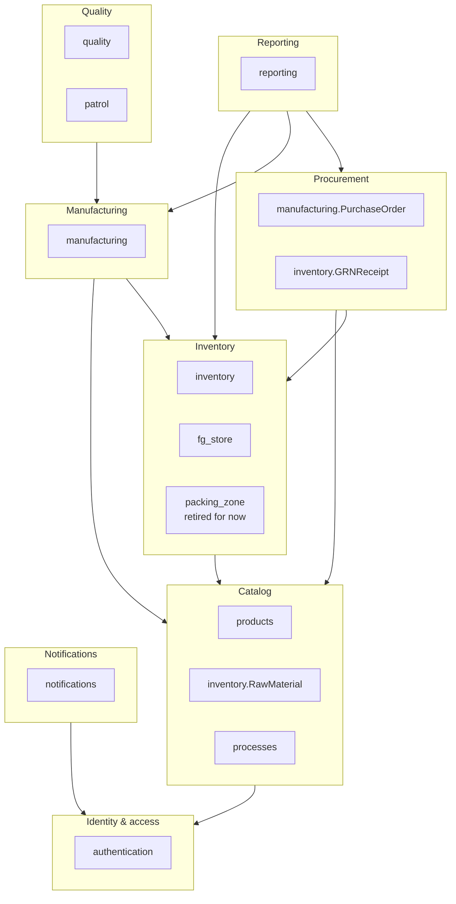

# Domain map

The domains below are **boundaries for code and ownership**, not deployment
units. Models stay in their current Django apps and tables. A workflow that spans
domains lives in the application service of the domain that owns the transaction.

## Domain to physical app

| Domain | Physical apps / models today | Responsibility |
|---|---|---|
| Identity & access | `authentication` | Users, profiles, roles, sessions, engagement, breaks |
| Catalog | `products`, `inventory.RawMaterial`, `processes` | Products, raw materials, processes, BOM |
| Inventory | `inventory`, `fg_store`, `packing_zone` | Stock ledger, GRN, heat numbers, FG stock, returns |
| Procurement | `manufacturing.PurchaseOrder`, `inventory.GRNReceipt` | Purchase orders and goods receipt |
| Manufacturing | `manufacturing` | MO, batch, process execution, allocations, rework, outsourcing |
| Quality | `quality`, `patrol` | Checks, traceability, patrol |
| Notifications | `notifications` | Workflow notifications |
| Reporting | `reporting` | Read models and reports |

## Cross-domain workflows

| Workflow | Owning service | Calls into |
|---|---|---|
| MO approval and RM reservation | `manufacturing.application` | `inventory.application.stock_service`, `authentication` selectors |
| GRN receipt and completion | `inventory.application.grn_service` | procurement read selector, `stock_service` |
| Batch process start/complete | `manufacturing.application` | `stock_service`, `notifications` |
| RM return disposition | `inventory.application.return_service` | `stock_service`, manufacturing read selectors |
| FG dispatch | `fg_store.application` | `stock_service`, manufacturing read selectors |

## Boundaries and deferred moves

- `PurchaseOrder` stays in `manufacturing` and `GRNReceipt` stays in `inventory`.
  Moving them would require table renames and migration risk; the split is
  documented rather than fixed.
- `packing_zone` is currently uninstalled and unrouted. Its models and code are
  kept, but the domain is retired until a later phase decides whether to wire it.
- Two `RMReturn` models exist and are both used by the frontend:
  `manufacturing.RMReturn` records what a supervisor returned from a batch;
  `inventory.RMReturn` records the RM Store's disposition. They are not merged in
  this phase; the stock effect is owned by one inventory service.
- `reporting` reads from inventory, manufacturing, and procurement. It must not
  become a writer or a second source of truth.
