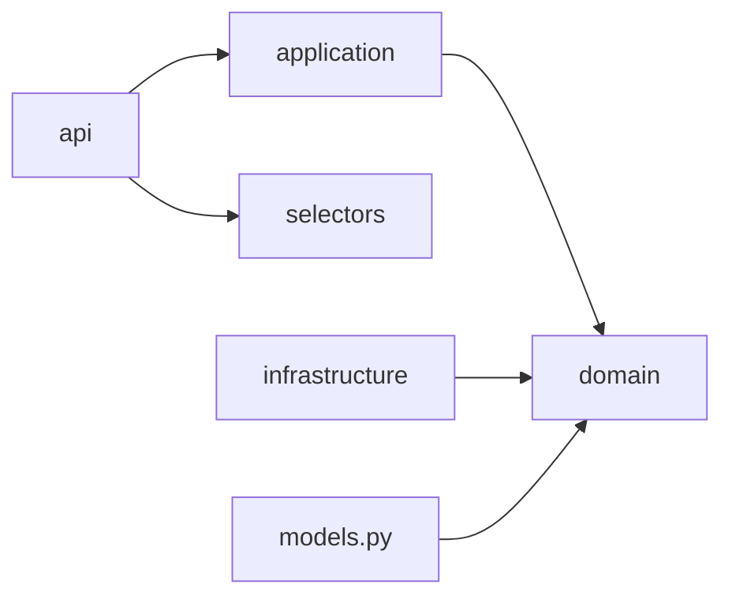
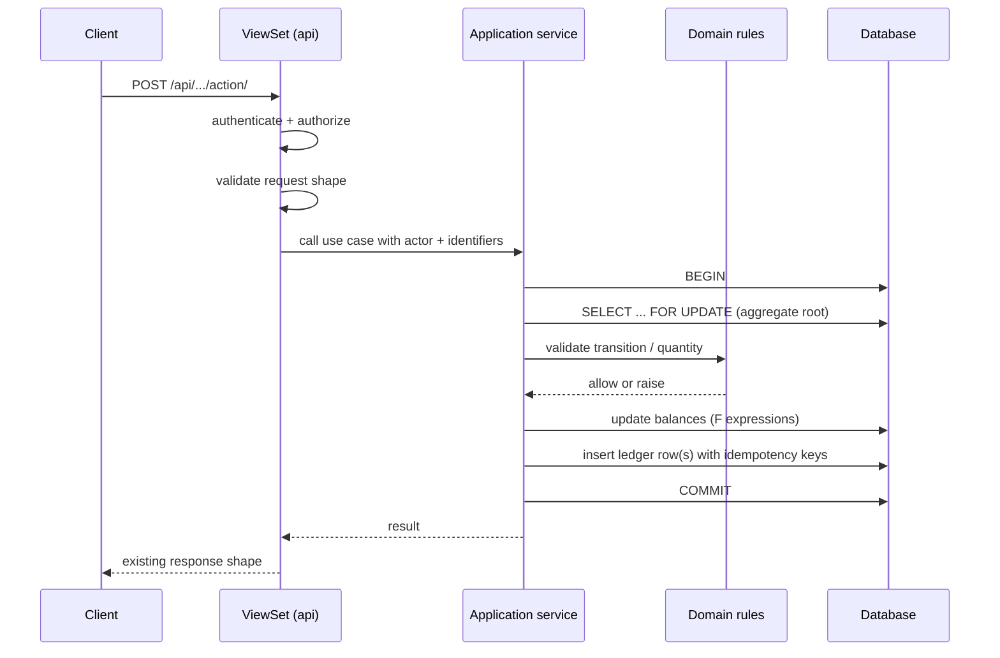

# Backend architecture overview

The backend is a Django modular monolith. It deploys as one process against one
database, but each app is organized into explicit layers so business rules,
transactions, and HTTP concerns stay separate.

- Design: [`docs/superpowers/specs/2026-10-28-backend-architecture-refactor-design.md`](../superpowers/specs/2026-10-28-backend-architecture-refactor-design.md)
- Decisions: [ADR 0001](decisions/0001-modular-monolith.md) ·
  [ADR 0002](decisions/0002-stock-ledger.md) ·
  [ADR 0003](decisions/0003-idempotency.md) ·
  [ADR 0004](decisions/0004-test-strategy.md)
- Domain map: [`domain-map.md`](domain-map.md)

## Layers

```
app/
  domain/          # Pure rules, value objects, state machines, exceptions
  application/     # Use-case services; own transaction boundaries
  selectors/       # Read-only query functions; no writes
  api/             # Viewsets, serializers, permissions, filters
  infrastructure/  # Adapters: ORM helpers, external services, file storage
  models.py        # Persistence models (kept where they are)
```

Dependency rule:



- Viewsets may call application services and selectors. They must not contain
  stock arithmetic, status transitions, or multi-model business rules.
- Serializers validate input shape. They do not decide business outcomes.
- Models may hold persistence-level invariants and small derived properties.
  They do not orchestrate other aggregates.
- Selectors never mutate.

Django app labels, database table names, and existing URLs are unchanged. The
refactor moves code inside apps, not tables.

## Request flow for a stock-changing endpoint



Rules that the flow enforces:

- The service owns the transaction boundary. A viewset never opens one around a
  stock write.
- The aggregate root (`RawMaterial`) is locked first; multi-material operations
  lock IDs in ascending order.
- Replays are detected by `operation_key`; each row also has a unique
  `idempotency_key` as the database guard.
- A failed validation rolls back the whole operation, including ledger rows and
  notifications.

## Runtime shape

| Concern | Today |
|---|---|
| HTTP | Django REST Framework, routers under `/api/<app>/` |
| Auth | JWT via `djangorestframework-simplejwt` |
| Database | MySQL 8 in production; SQLite in-memory for fast tests |
| Cache | Redis in production; locmem in tests |
| Static/media | WhiteNoise and Django storage |
| Health | `/health/` and `django-health-check` |
| API schema | `drf-spectacular` (added in Phase 0 tooling; exposed in a later phase) |

## What this refactor does not do

- It does not split the system into microservices.
- It does not rename apps, models, tables, or URLs.
- It does not change response shapes in Phases 0–2.
- It does not modify the separate Next.js frontend repository.
